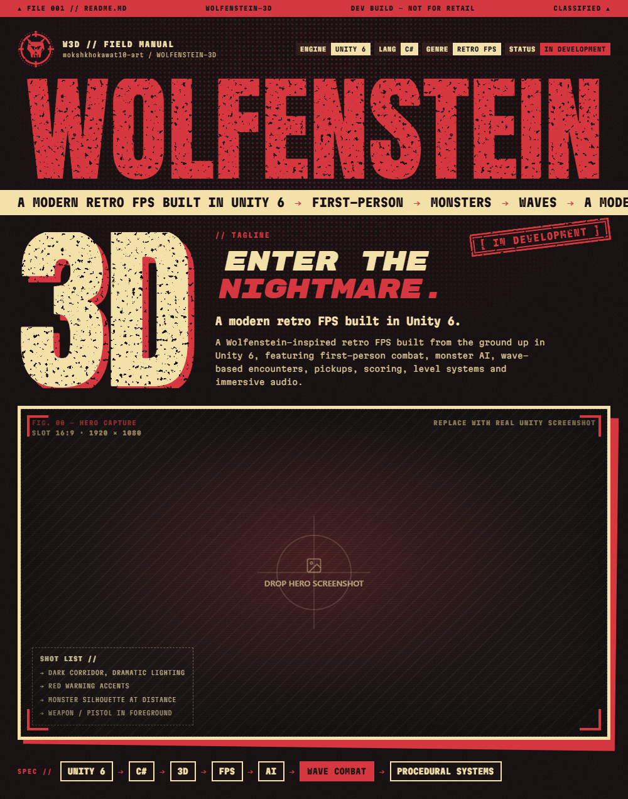
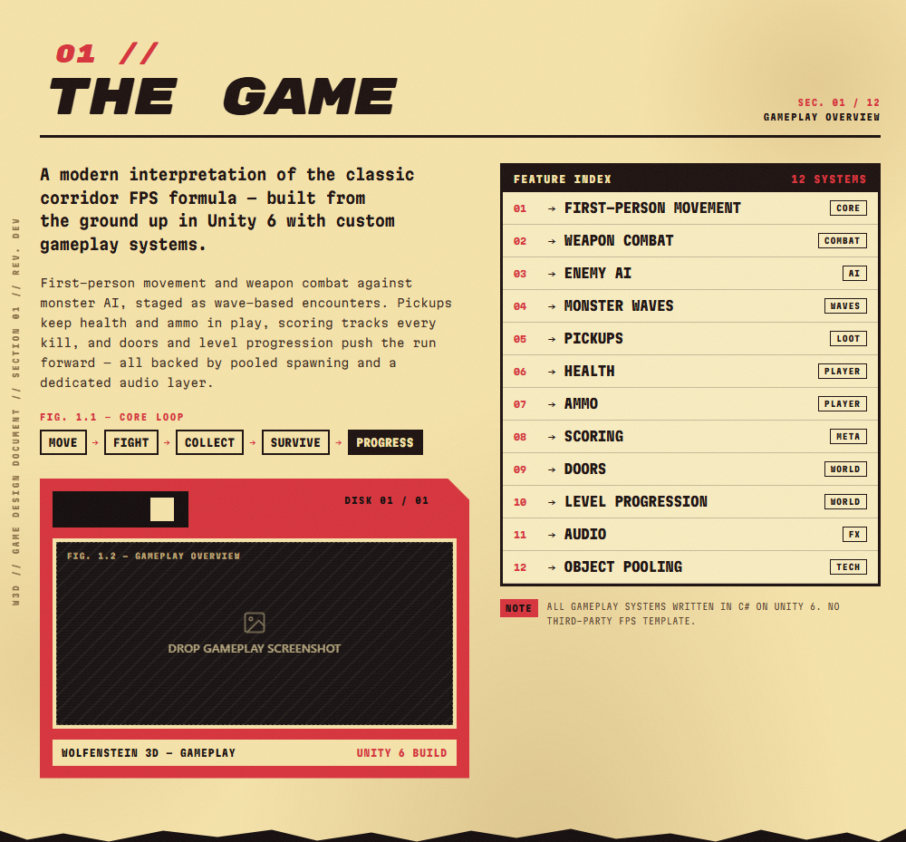
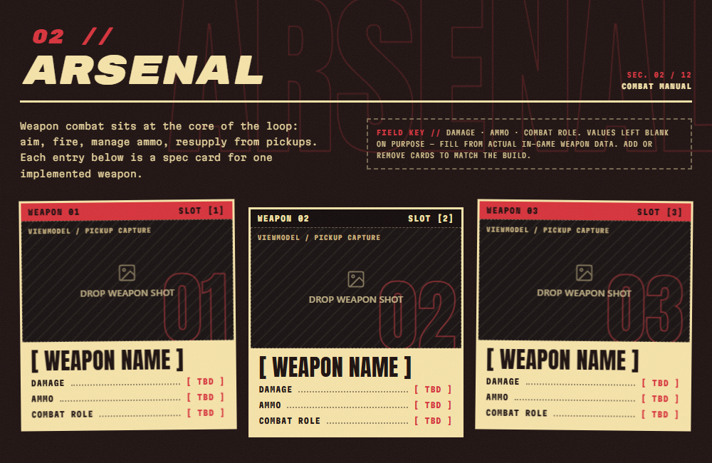
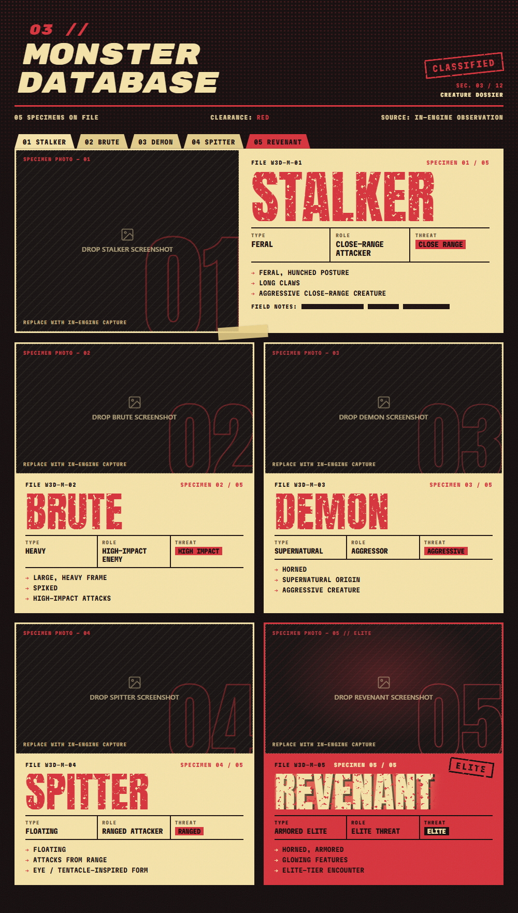
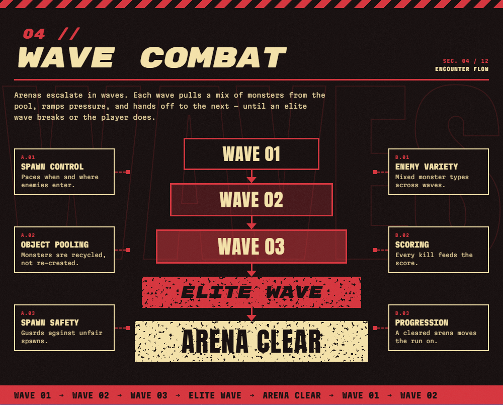
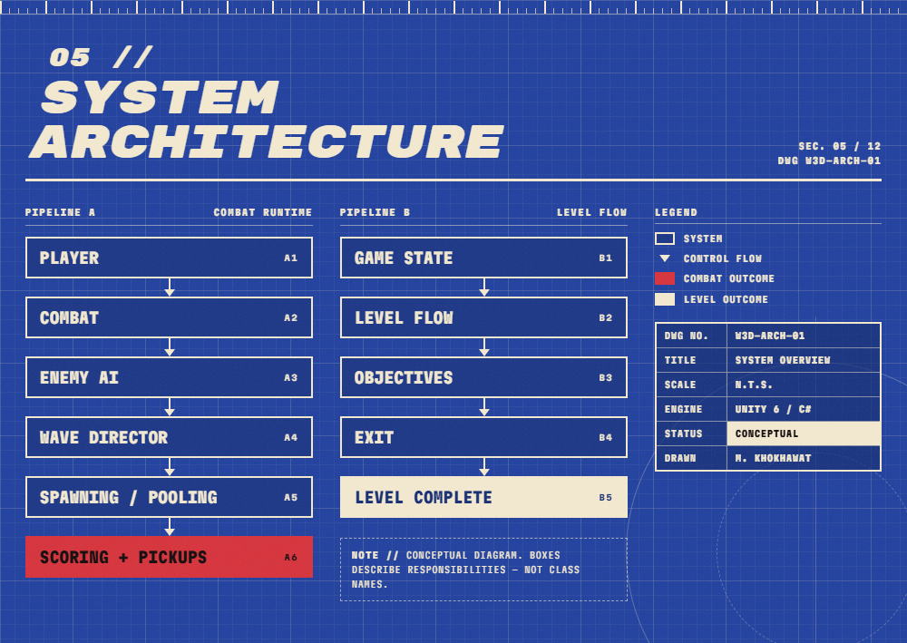
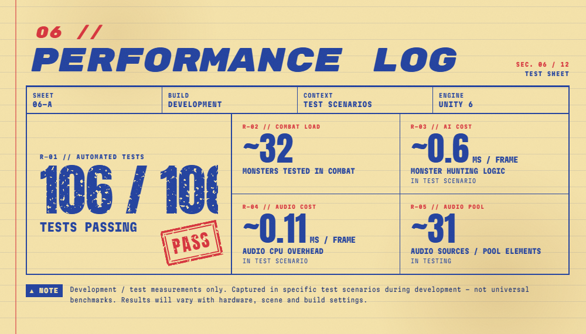
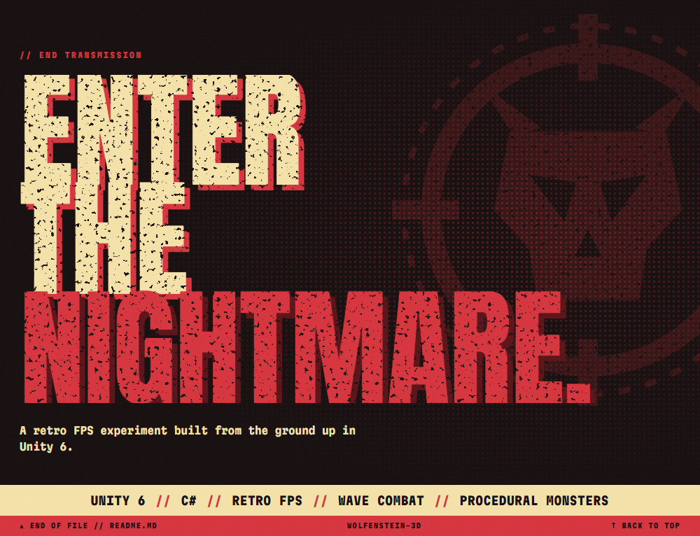

<!--
  WOLFENSTEIN 3D — README
  Visual banners are exported from the Claude Design project "Wolfenstein 3D README" (one PNG per section)
  into docs/readme/. The screenshot slots (docs/screenshots/*) are commented out below until real Unity
  captures are added to the repository; restore each one when its file exists.
-->

<p align="center">
  
</p>

<p align="center">
  
  
  
  
</p>

<h3 align="center">ENTER THE NIGHTMARE.</h3>
<p align="center">A modern retro FPS built in Unity 6.</p>

<p align="center">
  <a href="#01--the-game"><b>GAMEPLAY</b></a> →
  <a href="#02--arsenal"><b>ARSENAL</b></a> →
  <a href="#03--monster-database"><b>MONSTERS</b></a> →
  <a href="#04--wave-combat"><b>WAVES</b></a> →
  <a href="#05--system-architecture"><b>SYSTEMS</b></a> →
  <a href="#09--development-roadmap"><b>ROADMAP</b></a>
</p>

<!-- Hero screenshot — restore when docs/screenshots/hero.png exists:
<p align="center">
  
</p>
-->

---

## 01 // THE GAME



A Wolfenstein-inspired retro FPS built from the ground up in Unity 6, featuring first-person combat, monster AI, wave-based encounters, pickups, scoring, level systems and immersive audio. A modern interpretation of the classic corridor FPS formula, built with custom gameplay systems.

| | | |
|---|---|---|
| → First-person movement | → Weapon combat | → Enemy AI |
| → Monster waves | → Pickups | → Health |
| → Ammo | → Scoring | → Doors |
| → Level progression | → Audio | → Object pooling |

## 02 // ARSENAL



<!-- Weapon screenshots — add a first column with  (and -02, -03) when those files exist. -->
| Weapon | Damage | Ammo | Combat role |
|---|---|---|---|
| _Weapon name_ | _TBD_ | _TBD_ | _TBD_ |
| _Weapon name_ | _TBD_ | _TBD_ | _TBD_ |
| _Weapon name_ | _TBD_ | _TBD_ | _TBD_ |

## 03 // MONSTER DATABASE



| # | Specimen | Type | Role | Threat |
|---|---|---|---|---|
| 01 | **STALKER** — feral, hunched, long claws | Feral | Close-range attacker | Close range |
| 02 | **BRUTE** — large, heavy, spiked | Heavy | High-impact enemy | High impact |
| 03 | **DEMON** — horned, supernatural | Supernatural | Aggressor | Aggressive |
| 04 | **SPITTER** — floating, eye/tentacle-inspired | Floating | Ranged attacker | Ranged |
| 05 | **REVENANT** — horned, armored, glowing features | Armored elite | Elite threat | Elite |

## 04 // WAVE COMBAT



`WAVE 01 → WAVE 02 → WAVE 03 → ELITE WAVE → ARENA CLEAR`

Spawn control · Object pooling · Spawn safety · Enemy variety · Scoring · Progression

## 05 // SYSTEM ARCHITECTURE



```
PIPELINE A — COMBAT RUNTIME        PIPELINE B — LEVEL FLOW
PLAYER                             GAME STATE
  ↓                                  ↓
COMBAT                             LEVEL FLOW
  ↓                                  ↓
ENEMY AI                           OBJECTIVES
  ↓                                  ↓
WAVE DIRECTOR                      EXIT
  ↓                                  ↓
SPAWNING / POOLING                 LEVEL COMPLETE
  ↓
SCORING + PICKUPS
```
> Conceptual diagram — boxes describe responsibilities, not class names.

## 06 // PERFORMANCE LOG



| Reading | Measurement | Context |
|---|---|---|
| **106 / 106** | Tests passing | Automated tests |
| **~32** | Monsters tested in combat | Test scenario |
| **~0.6 ms/frame** | Monster hunting logic | Test scenario |
| **~0.11 ms/frame** | Audio CPU overhead | Test scenario |
| **~31** | Audio sources / pool elements | In testing |

> Development / test measurements only — not universal benchmarks. Results vary with hardware, scene and build settings.

<!-- 07 // FIELD DOCUMENTATION — restore this section when the six docs/screenshots/* captures exist:
## 07 // FIELD DOCUMENTATION

| | | |
|---|---|---|
| <br>**FIG. 07.1 — GAMEPLAY** | <br>**FIG. 07.2 — COMBAT** | <br>**FIG. 07.3 — MONSTER WAVE** |
| <br>**FIG. 07.4 — ENVIRONMENT** | <br>**FIG. 07.5 — HUD** | <br>**FIG. 07.6 — WEAPONS** |
-->

## 08 // TECHNICAL SPECIFICATION

`UNITY 6` `C#` `3D` `AI` `PROCEDURAL SYSTEMS` `OBJECT POOLING` `GIT` `GITHUB`

## 09 // DEVELOPMENT ROADMAP

**Current status: IN DEVELOPMENT**

| Phase | Milestone | Status |
|---|---|---|
| 01 | Core FPS Foundation | ☐ |
| 02 | Movement & Combat | ☐ |
| 03 | Enemies & Level Systems | ☐ |
| 04 | Core Gameplay | ☐ |
| 05 | Pickups, Health, Ammo & Scoring | ☐ |
| 06 | Monsters, Waves & Environment | ☐ |
| 07 | Audio Systems | ☐ |
| 08 | Level Progression & Complete Game Flow | ☐ |
| 09 | Advanced Weapons & Combat | ☐ |
| 10 | Bosses & Special Encounters | ☐ |
| 11 | Menus, Settings & Game States | ☐ |
| 12 | Final Visual / Audio Polish | ☐ |
| 13 | QA, Balancing & Release | ☐ |
| 14 | Documentation / Portfolio | ☐ |

> Mark a phase ✅ only once it ships in the repository.

## 10 // CONTROLS

| Input | Action |
|---|---|
| `W` `A` `S` `D` | Move |
| `Mouse` | Look |
| `Left Click` | Fire |
| `Esc` | Pause |

## 11 // RUN THE GAME

1. Clone the repository
2. Open the project in Unity 6
3. Open the main gameplay scene
4. Press Play

```bash
git clone https://github.com/mokshkhokawat10-art/WOLFENSTEIN-3D
```

## 12 // PROJECT STRUCTURE

```
Assets/
├── Player/
├── Combat/
├── Enemies/
├── Gameplay/
├── Levels/
├── Audio/
├── UI/
└── Tests/
```
> Conceptual structure — update to mirror the actual repository.

---

| AUTHOR | PROJECT | ENGINE | STATUS |
|---|---|---|---|
| Moksh Khokhawat | WOLFENSTEIN 3D | UNITY 6 | IN DEVELOPMENT |

<p align="center">
  
</p>

<p align="center"><b>UNITY 6 // C# // RETRO FPS // WAVE COMBAT // PROCEDURAL MONSTERS</b></p>
